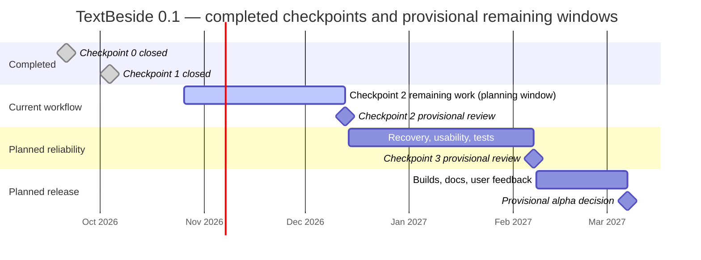

# Development roadmap

Updated **26 October 2026**. This is a working plan for a small, part-time project. Completed work is recorded separately from **provisional planning windows**, which are not release promises or assigned deadlines. Progress is judged by the exit evidence in the linked GitHub issues.

## Current position

Checkpoints 0 and 1 are complete. **Checkpoint 2 — reliable paired-file navigation — is in progress.** Its discovery and pairing helpers, image-first transcription workflow, and manual mismatch warning are merged on `main`. Previous/next navigation is the next implementation step; the full directory workflow is not complete.

| Checkpoint | Status as of 26 Oct 2026 | Timing | What it proves | Live progress |
| --- | --- | --- | --- | --- |
| 0. Working agreement | Complete | Closed 21 Sep 2026 | Contribution rules and first implementation tasks are ready | [#1](https://github.com/GeoffRiley/TextBeside/issues/1) |
| 1. Split-view prototype | Complete | Closed 4 Oct 2026 | One image/text pair can be edited safely; zoom and pan feel good | [#2](https://github.com/GeoffRiley/TextBeside/issues/2) |
| 2. Pair navigation | In progress | Current work; provisional review by 13 Dec 2026 | A directory of pages can be transcribed without mismatches or overwrites | [#3](https://github.com/GeoffRiley/TextBeside/issues/3) |
| 3. Daily use | Planned | Provisional: 14 Dec 2026–7 Feb 2027, after Checkpoint 2 | A longer session is predictable and recoverable | [#4](https://github.com/GeoffRiley/TextBeside/issues/4) |
| 4. Alpha | Planned | Provisional: 8 Feb–7 Mar 2027, after Checkpoint 3 | Another person can install and use 0.1 on Linux and Windows | [#5](https://github.com/GeoffRiley/TextBeside/issues/5) |

The original September planning windows have been superseded for completed work. Future review windows are retained as provisional estimates; reassess them when Checkpoint 2 closes rather than treating them as commitments.

## Checkpoint 2: completed and remaining work

| Slice | Status | Evidence and limits |
| --- | --- | --- |
| 2A: image discovery and natural ordering | Complete — [#13](https://github.com/GeoffRiley/TextBeside/issues/13) | Nonrecursive discovery and deterministic natural ordering are on `main`; folder-selection UI remains to be connected. |
| 2B: counterpart resolution | Complete — [#14](https://github.com/GeoffRiley/TextBeside/issues/14) | Explicit missing/matched/conflicting results for same-basename `.md`/`.txt` files; navigation conflict-choice UI remains. |
| 2C: start from an unpaired image | Complete — [#15](https://github.com/GeoffRiley/TextBeside/issues/15), merged [PR #19](https://github.com/GeoffRiley/TextBeside/pull/19) | Empty in-memory transcription, first-save format choice and no-overwrite creation; manually tested on Windows and Linux. |
| Manual filename-mismatch safeguard | Complete — [#20](https://github.com/GeoffRiley/TextBeside/issues/20), merged [PR #21](https://github.com/GeoffRiley/TextBeside/pull/21) | Explicit **Open anyway**, safe cancellation and preserved intentional mismatches; Windows/Linux manual confirmation. Review follow-up detects transcription changes during loading. |
| 2D: previous/next paired-page navigation | **Next — [#16](https://github.com/GeoffRiley/TextBeside/issues/16)** | Reuse discovery, counterpart resolution and save protection; implementation and cross-platform walkthrough remain. |
| Complete directory workflow and checkpoint review | Outstanding — [#3](https://github.com/GeoffRiley/TextBeside/issues/3) | Folder opening/rescanning, usable navigation and explicit conflict handling must meet the parent checkpoint's exit checks before closure. |

The merged mismatch safeguard has **55 passing automated tests** across the application suite, with Ruff lint and formatting checks passing. This is a dated evidence snapshot, not a fixed test-count target. The [manual-pair walkthrough](docs/manual-pair-warning-walkthrough.md) documents interactive checks.

## Immediate next step: Issue #16

- Add Previous / Next controls for the naturally ordered images in the working directory, with predictable first/last-page behavior and no unexpected wrapping.
- Load the corresponding transcription or a safe missing-counterpart state. Require a user decision for conflicting `.md`/`.txt` counterparts.
- Preserve **Save / Discard / Cancel** protection, including cancelled or failed first saves. Cancelled navigation or unavailable files must retain the current work and unsaved edits.
- Cover the two sample pages and temporary missing/conflicting counterparts in integration checks and a Linux/Windows manual walkthrough.
- Retain manual **Open pair**, including intentional mismatches and the new warning.

A multi-image manifest or control file associating multiple images with one transcription is **outside 0.1**.

## Later checkpoint gates

**Checkpoint 3 — daily use:** complete the remaining image controls and view restoration, find/replace and keyboard accessibility, persistent window/recent-folder state, and a tested autosave/recovery policy. Record a 45-minute transcription session and address data-loss defects before declaring the checkpoint complete. Existing fit-image/100% controls and save protection provide a starting point, not completion of this gate.

**Checkpoint 4 — installable alpha:** add automated PR checks, produce and test Linux/Windows builds, include dependency licence notices and current user documentation, run the same end-to-end workflow on both platforms, and gather feedback from at least two transcription users. No packaged alpha has been released.

## How to use the plan

- The [README](README.md) describes current usage, product scope and longer-term ideas. This page records checkpoint status, provisional timing and next steps. Linked issues hold acceptance checks and evidence.
- Work on the current checkpoint first, in small implementation slices. The immediate next slice is [#16](https://github.com/GeoffRiley/TextBeside/issues/16).
- A checkpoint is complete after its hands-on demonstration and safety checks, with evidence recorded in its issue. Carry a missing feature forward only by documenting the scope change.
- Review estimates at each checkpoint. A safe save path takes precedence over a calendar target.
- Update **README.md and ROADMAP.md alongside relevant feature, workflow or status changes**, so merged documentation describes `main` accurately.
- Phase 5 ideas in the README are a post-alpha backlog without dates. Prioritise them after feedback.

Checkpoint issues are the current source of truth for progress; native GitHub milestones are not required by this plan.
